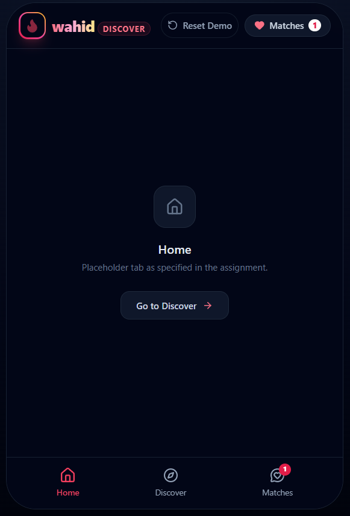
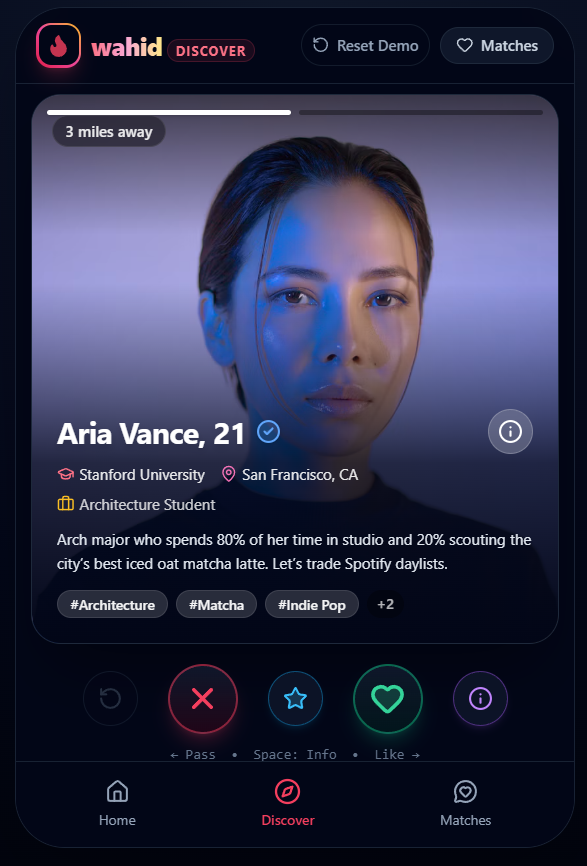
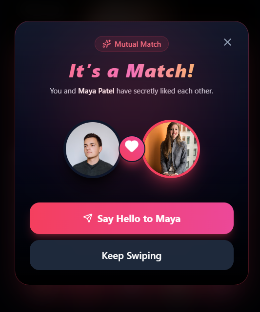
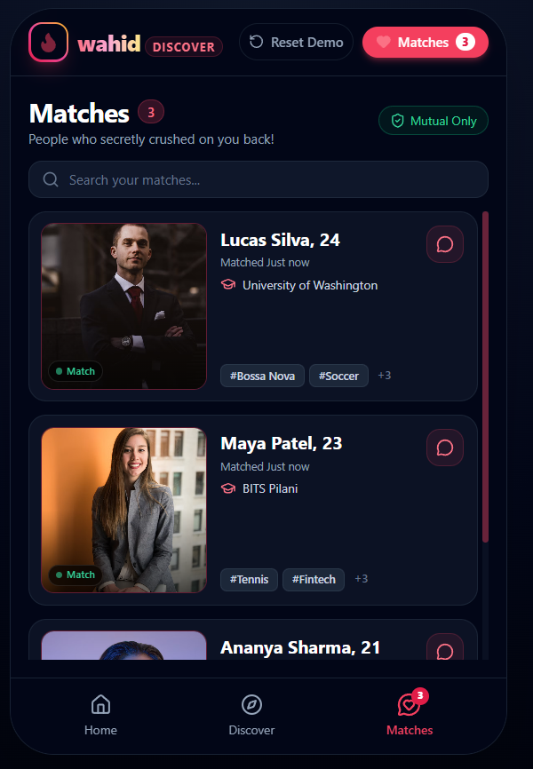
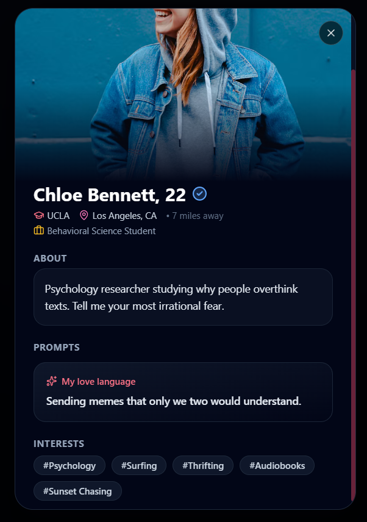
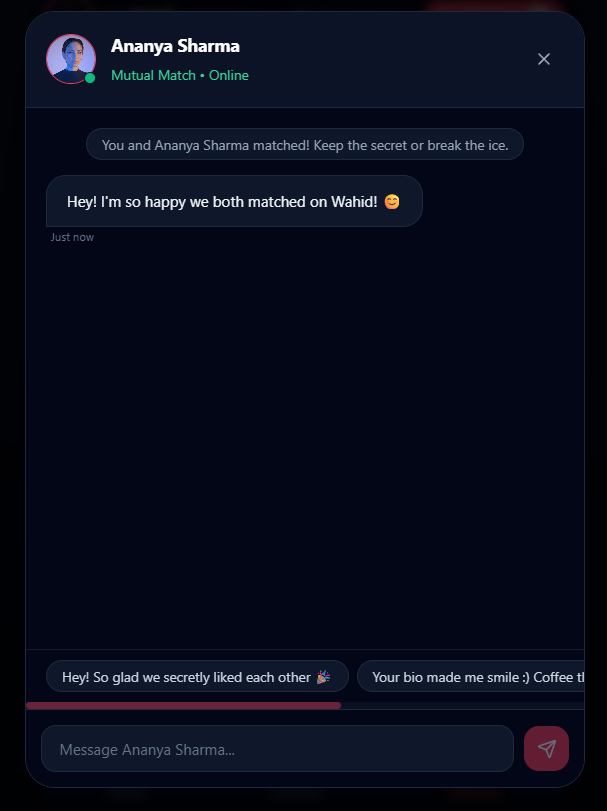
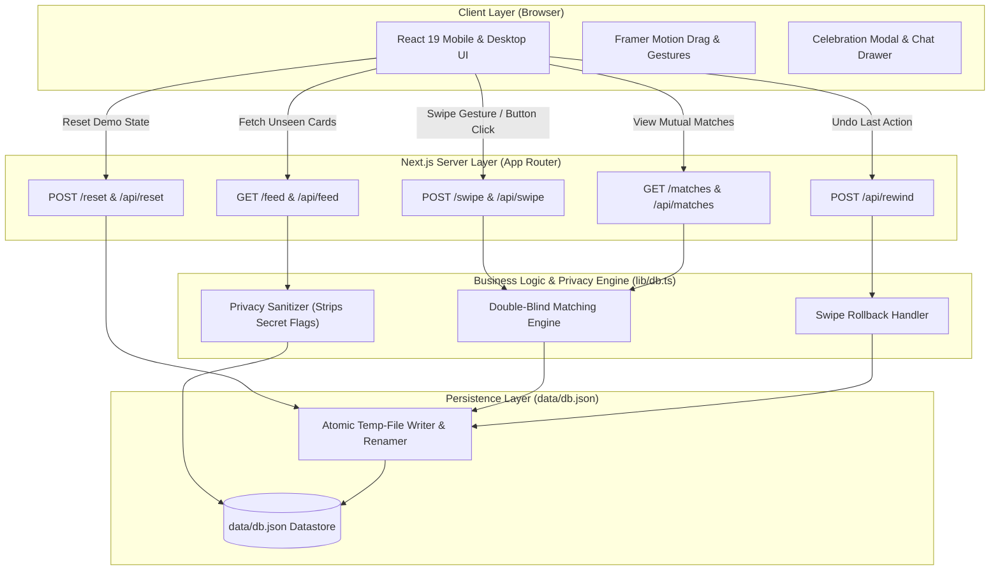

# WAHID DISCOVER

<p align="center">
  <strong>A high-intent, swipe-based discovery application engineered with fluid gesture physics, double-blind matching, and zero-knowledge privacy guarantees.</strong>
</p>

<p align="center">
  
  
  
  
  
  
  
</p>

---

## Table of Contents

- [Project Overview](#project-overview)
- [Screenshots & UI Walkthrough](#screenshots--ui-walkthrough)
- [Key Features](#key-features)
- [Tech Stack & Rationale](#tech-stack--rationale)
- [Application Architecture](#application-architecture)
- [Matching Logic & State Machine](#matching-logic--state-machine)
- [Privacy & Anti-Leakage Guarantees](#privacy--anti-leakage-guarantees)
- [Backend API Specification](#backend-api-specification)
- [Repository Structure](#repository-structure)
- [Installation & Local Setup](#installation--local-setup)
- [Automated Testing](#automated-testing)
- [Part A: Coy Product Analysis & Feature Proposals](#part-a-coy-product-analysis--feature-proposals)
- [Future Roadmap](#future-roadmap)
- [Author & Acknowledgments](#author--acknowledgments)

---

## Project Overview

**WAHID DISCOVER** is a mobile-first, gesture-driven social discovery application built as the core deliverable for the **Coy SDE Intern Assignment**.

While traditional dating platforms suffer from endless superficial swiping, and anonymous crush apps face the "deadlock dilemma" where users hesitate to spend scarce crush slots, Wahid Discover bridges the gap. It introduces a high-retention discovery interface alongside a strictly enforced **double-blind matching engine**:

- Users browse curated mock profiles with rich media, bios, prompt Q&As, and interest tags.
- Mutual interest triggers an instant celebration and unlocks direct messaging.
- Unreciprocated likes remain completely private and zero-knowledge: no third party or client-side inspection can ever determine who liked whom unless the match is reciprocal.

The project consists of two core milestones:
1. **Part A (Product Strategy & Systems Thinking)**: A comprehensive product analysis of Coy's live mobile consumer experience (`app.getcoy.com`), detailing psychological bottlenecks and proposing two scalable, privacy-preserving core features.
2. **Part B (Production Engineering)**: A fully responsive, swipe-based discovery client and companion Next.js backend with atomic persistence, mobile touch gestures, desktop controls, and 100% automated test coverage.

---

## Screenshots & UI Walkthrough

Explore the key screens and features of **Wahid Discover**, captured directly from the live application:

| 1. Home Tab (Placeholder) | 2. Discover Tab (Profile Stack) |
| :---: | :---: |
| <br>*(Minimal placeholder tab preserving Coy navigation)* | <br>*(Browse profiles with fluid gestures, stamps & tags)* |

| 3. Mutual Match Celebration Modal | 4. Matches Tab (Dashboard) |
| :---: | :---: |
| <br>*(Celebration modal with confetti when two users mutually like)* | <br>*(Mutual matches view with zero-leakage privacy guarantee)* |

| 5. Profile Details Modal | 6. Interactive Chat Drawer |
| :---: | :---: |
| <br>*(Expanded bio, education, prompts & interest badges)* | <br>*(Direct messaging drawer with simulated icebreaker prompts)* |

---

## Key Features

### 1. 32 Seeded Mock Profiles
- Seeded with 32 diverse, realistic profiles spanning universities such as Stanford, UC Berkeley, Columbia, NYU, IIT Delhi, BITS Pilani, UCLA, and Harvard.
- Each profile includes:
  - High-resolution photography and multi-photo galleries with tap navigation.
  - Name, age, verified badge, and current university or city.
  - Authentic bios and structured prompt Q&As (e.g., *"Typical Sunday morning"*, *"A non-negotiable for me"*).
  - Categorized interest badges (`#FilmPhotography`, `#UI/UXDesign`, `#IndieRock`, `#Boba`, etc.).

### 2. Fluid Gesture & Physics Engine
- **Mobile Touch Gestures**: Built with Framer Motion drag mechanics. Includes natural card drag elasticity (`dragElastic={0.85}`) and rotation derived directly from horizontal offset ($x / 14^\circ$).
- **Dynamic Stamps**: Real-time **LIKE** (emerald border with glowing backdrop) and **NOPE** (ruby-red border with glowing backdrop) badges that interpolate opacity according to drag displacement.
- **Card Release Physics**: Throws cards off-screen along their velocity vector if drag displacement exceeds $110\text{px}$ or velocity exceeds $400\text{px/s}$; otherwise, cards spring back smoothly to the center.
- **Card Depth Stacking**: Renders the upcoming card underneath with a subtle scale (`0.94`) and offset (`12px`), expanding smoothly as the active card exits.

### 3. Desktop Accessibility & Controls
- **Action Buttons**: Floating bottom controls for **Pass** (❌), **Rewind/Undo** (↩️), **Super Like** (⭐), **Like** (💚), and **Profile Info** (ℹ️).
- **Keyboard Shortcuts**:
  - `←` or `A`: Pass (Swipe Left)
  - `→` or `D`: Like (Swipe Right)
  - `Backspace` or `Z`: Rewind / Undo previous swipe
  - `Space` or `I`: Open full profile detail modal

### 4. Double-Blind Mutual Matching
- Matches happen **if and only if** both parties express positive interest.
- Ten seeded profiles have already liked the logged-in user secretly.
- **Sarah Chen (`p2`)** is positioned as the 2nd card in the stack: passing on `p1` (Aria Vance) and liking `p2` (Sarah Chen) instantly triggers a verified mutual match.

### 5. Match Celebration Modal
- Animated full-screen celebration modal triggered upon mutual match.
- GPU-accelerated multi-color particle confetti powered by `canvas-confetti`.
- Overlapping glowing avatars with an animated heart indicator.
- Action options: **"Say Hello"** (opens conversation drawer) or **"Keep Swiping"** (continues feed).

### 6. Matches Dashboard & Interactive Chat
- Displays all established mutual matches with timestamps (*"Just now"*, *"5m ago"*), university tags, and online indicators.
- Live search filter to find matches by name or college.
- **Interactive Chat Drawer**: Send custom messages or one-tap icebreakers (*"Hey! So glad we matched 🎉"*, *"Coffee this week?"*).
- Includes simulated witty replies after a 1.2-second typing delay to demonstrate the complete messaging loop.

### 7. Swipe Persistence & Demo Reset
- File-backed atomic JSON store (`data/db.json`) persisting all swipes and matches across browser reloads and server restarts.
- **Strict One-Time Presentation**: Swiped profiles are permanently filtered from future feed queries.
- **Undo / Rewind Capability**: Allows rolling back the previous swipe and restoring the card to the stack.
- **Reset Demo**: One-click reset button in the header that resets the database back to its pristine seeded state.

---

## Tech Stack & Rationale

| Layer | Technology | Version | Purpose / Rationale |
| :--- | :--- | :--- | :--- |
| **Framework** | [Next.js](https://nextjs.org/) | `15.5.29` | Full-stack App Router with hybrid SSR, static generation, and high-performance serverless API routes. |
| **Frontend Library** | [React](https://react.dev/) | `19.0.0` | Modern component architecture, hooks (`useMotionValue`, `useTransform`, `useImperativeHandle`), and concurrent rendering. |
| **Language** | [TypeScript](https://www.typescriptlang.org/) | `5.0+` | End-to-end static typing across database schemas, API contracts, and component interfaces. |
| **Styling** | [Tailwind CSS](https://tailwindcss.com/) | `3.4.1` | Utility-first CSS with custom dark palette (`#0F0F12`), hot pink accents (`#FF3366`), and responsive breakpoints. |
| **Animation & Gestures** | [Framer Motion](https://www.framer.com/motion/) | `12.4.7` | Hardware-accelerated drag gestures, spring physics, exit trajectories, and keyframe state transitions. |
| **Particle Effects** | [canvas-confetti](https://www.npmjs.com/package/canvas-confetti) | `1.9.4` | Canvas-based celebratory confetti burst animations for mutual match moments. |
| **Iconography** | [Lucide React](https://lucide.dev/) | `1.16.0` | Accessible, consistent SVG icons across navigation and action buttons. |
| **Persistence** | File-backed JSON DB | Native Node.js `fs` | Lightweight, zero-dependency atomic JSON datastore (`data/db.json`) with safe temporary-file write-and-rename mechanics. |
| **Testing Harness** | Node.js Test Runner with `tsx` | `4.23.15` | Native ESM test suite runner verifying backend privacy contracts, matching logic, and persistence without external overhead. |

---

## Application Architecture

The application is structured into decoupled layers, ensuring clear separation of concerns between presentation, business rules, privacy enforcement, and storage.



---

## Matching Logic & State Machine

The double-blind matching algorithm operates under a deterministic state machine:

1. **Feed Delivery**:
   - The user requests `GET /feed`.
   - The database reads all seeded profiles and excludes any `profileId` present in `db.swipes`.
   - All internal flags (`inboundLikes`, `hasLikedUser`, `isMatch`) are stripped before sending the payload to the client.

2. **Swipe Submission (`POST /swipe`)**:
   - The user dispatches a swipe action with `{ profileId: string, direction: "like" | "pass" }`.
   - If the profile was already swiped on, the request is safely acknowledged without duplicate writes.
   - The swipe is recorded in `db.swipes` with an ISO timestamp.

3. **Evaluation Condition**:
   $$\text{Match} \iff (\text{direction} == \text{"like"}) \land (\text{profileId} \in \text{db.inboundLikes})$$
   - **Case A: Mutual Match**: If the user liked the profile and that profile is in `db.inboundLikes`, a new match record is appended to `db.matches`, and the server returns `{ success: true, match: true, matchedProfile }`.
   - **Case B: One-Sided Like**: If the profile has not liked the user, the server returns `{ success: true, match: false }`. The profile is permanently excluded from the feed, but no match is logged.
   - **Case C: Pass**: Regardless of whether the target liked the user, passing yields `{ success: true, match: false }`. No match is ever created.

4. **Rollback (`POST /api/rewind`)**:
   - The most recent entry in `db.swipes` is popped.
   - If that entry generated a match in `db.matches`, that match is removed.
   - The restored profile is returned to the client and placed back at the top of the feed stack.

---

## Privacy & Anti-Leakage Guarantees

> **The Core Coy Guarantee**: Never reveal who has liked the user unless the feeling is mutual.

To prevent inadvertent data leakage, the following architectural defenses are implemented:

1. **Zero Client-Side Leakage**:
   - The secret list of profiles that have liked the user (`inboundLikes`) is stored exclusively in `data/db.json`.
   - `getFeedProfiles()` explicitly sanitizes each profile object. The client bundle and network payloads never receive boolean flags such as `hasLikedUser`, `isCrush`, or `inboundLikes`.
   - Inspecting browser Network tabs, client-side Redux/Zustand caches, or DOM nodes will reveal zero information about incoming likes.
2. **Server-Side Evaluation**:
   - The frontend never decides whether a card swipe is a match.
   - The evaluation is performed strictly inside the server-side `recordSwipe()` routine.
3. **Plausible Deniability on Unreciprocated Swipes**:
   - When a user likes someone who has not liked them back, the server response is indistinguishable from a pass: `{ success: true, match: false }`.
   - The target is never notified that they were liked unless they independently like the user back.

---

## Backend API Specification

All routes are dual-mapped to both root paths (e.g., `/feed`) and standard Next.js API paths (e.g., `/api/feed`).

### 1. Retrieve Discovery Feed
Returns all profiles the logged-in user has not yet swiped on, sorted in demo sequence.

- **Method**: `GET`
- **Endpoints**: `/feed`, `/api/feed`
- **Headers**: `Content-Type: application/json`
- **Response**: `200 OK`
```json
[
  {
    "id": "p1",
    "name": "Aria Vance",
    "age": 21,
    "photo": "https://images.unsplash.com/photo-1534528741775-53994a69daeb?auto=format&fit=crop&w=1000&q=80",
    "photos": [
      "https://images.unsplash.com/photo-1534528741775-53994a69daeb?auto=format&fit=crop&w=1000&q=80",
      "https://images.unsplash.com/photo-1517841905240-472988babdf9?auto=format&fit=crop&w=1000&q=80"
    ],
    "bio": "Arch major who spends 80% of her time in studio and 20% hunting for the best matcha.",
    "city": "San Francisco, CA",
    "college": "Stanford University",
    "interests": ["Architecture", "Matcha", "Film Photography", "Indie Pop"],
    "occupation": "Architecture Student",
    "distance": "3 miles away"
  }
]
```

### 2. Record Swipe (Like / Pass)
Records a swipe and evaluates mutual match conditions.

- **Method**: `POST`
- **Endpoints**: `/swipe`, `/api/swipe`
- **Headers**: `Content-Type: application/json`
- **Request Body**:
```json
{
  "profileId": "p2",
  "direction": "like"
}
```
*(Accepts flexible field names: `profileId` or `targetId`, `direction` or `action`, `'like' | 'pass' | 'right' | 'left'`)*

- **Response (Mutual Match Established)**: `200 OK`
```json
{
  "success": true,
  "match": true,
  "matchedProfile": {
    "id": "p2",
    "name": "Sarah Chen",
    "age": 22,
    "photo": "https://images.unsplash.com/photo-1517841905240-472988babdf9?auto=format&fit=crop&w=1000&q=80",
    "bio": "EECS @ Cal. Building developer tools and searching for the city's crispest sourdough.",
    "college": "UC Berkeley"
  }
}
```

- **Response (No Match / Pass)**: `200 OK`
```json
{
  "success": true,
  "match": false
}
```

- **Error Responses**:
  - `400 Bad Request`: Missing `profileId` or invalid `direction`.
  - `404 Not Found`: Profile ID does not exist in the database.

### 3. List Mutual Matches
Returns all established mutual matches.

- **Method**: `GET`
- **Endpoints**: `/matches`, `/api/matches`
- **Response**: `200 OK`
```json
[
  {
    "matchId": "match_1763428800000_a9f2x",
    "profileId": "p2",
    "matchedAt": "2026-11-18T01:00:00.000Z",
    "lastMessage": null,
    "profile": {
      "id": "p2",
      "name": "Sarah Chen",
      "age": 22,
      "photo": "https://images.unsplash.com/photo-1517841905240-472988babdf9?auto=format&fit=crop&w=1000&q=80",
      "college": "UC Berkeley"
    }
  }
]
```

### 4. Rewind Last Swipe (Undo)
Rolls back the most recent swipe action and restores the profile to the active feed.

- **Method**: `POST`
- **Endpoint**: `/api/rewind`
- **Response**: `200 OK`
```json
{
  "success": true,
  "message": "Rewound last swipe",
  "rewoundProfile": {
    "id": "p1",
    "name": "Aria Vance"
  }
}
```

### 5. Reset Database
Resets database state back to 32 profiles with 0 swipes, 0 matches, and restored inbound likes.

- **Method**: `POST`
- **Endpoints**: `/reset`, `/api/reset`
- **Response**: `200 OK`
```json
{
  "success": true,
  "message": "Database has been reset to initial seeded state."
}
```

---

## Repository Structure

```
coy/
├── app/
│   ├── api/
│   │   ├── feed/route.ts          # GET /api/feed handler
│   │   ├── matches/route.ts       # GET /api/matches handler
│   │   ├── reset/route.ts         # POST /api/reset handler
│   │   ├── rewind/route.ts        # POST /api/rewind handler
│   │   └── swipe/route.ts         # POST /api/swipe handler
│   ├── feed/route.ts              # GET /feed alias handler
│   ├── matches/route.ts           # GET /matches alias handler
│   ├── reset/route.ts             # POST /reset alias handler
│   ├── swipe/route.ts             # POST /swipe alias handler
│   ├── globals.css                # Global CSS & Tailwind layers
│   ├── layout.tsx                 # Root layout & Wahid branding metadata
│   └── page.tsx                   # Main tab router (Home, Discover, Matches)
├── components/
│   ├── ActionButtons.tsx          # Floating swipe, rewind & info controls
│   ├── BottomNav.tsx              # Bottom navigation bar (Home, Discover, Matches)
│   ├── CardStack.tsx              # Framer Motion card stack & gesture handling
│   ├── ChatModal.tsx              # Simulated interactive chat drawer
│   ├── DiscoverTab.tsx            # Main swipe discovery container
│   ├── EmptyState.tsx             # Out-of-profiles state with reset action
│   ├── Header.tsx                 # Top branding bar with Wahid logo & reset button
│   ├── HomeTab.tsx                # Minimal placeholder Home tab
│   ├── MatchesView.tsx            # Responsive 42/58 mutual matches dashboard
│   ├── MatchModal.tsx             # "It's a Match!" celebration modal & confetti
│   ├── ProfileCard.tsx            # Multi-photo card with info & dynamic stamps
│   └── ProfileDetailModal.tsx     # Full-screen profile info view
├── data/
│   └── db.json                    # File-backed atomic datastore
├── docs/
│   └── screenshots/               # Screenshot media assets
├── lib/
│   ├── db.ts                      # Core database operations & privacy sanitizer
│   ├── seedData.ts                # 32 seeded mock profiles & 10 inbound likes
│   └── types.ts                   # TypeScript interfaces & data contracts
├── tests/
│   └── api.test.mjs               # 11 unit & integration test suites
├── next.config.mjs                # Next.js configuration
├── package.json                   # Scripts and project dependencies
├── postcss.config.js              # PostCSS plugins configuration
├── tailwind.config.js             # Custom Tailwind color palette & themes
└── tsconfig.json                  # TypeScript compiler settings
```

---

## Installation & Local Setup

### Prerequisites
- [Node.js](https://nodejs.org/) v18.17+ or v20+
- `npm` (v9+) or `yarn`

### 1. Clone the Repository
```bash
git clone https://github.com/<your-username>/wahid-discover.git
cd wahid-discover
```

### 2. Install Dependencies
```bash
npm install
```

### 3. Run the Development Server
```bash
npm run dev
```
Open your browser and navigate to [http://localhost:3000](http://localhost:3000).

### 4. Build for Production
To test an optimized production build:
```bash
npm run build
npm start
```

### 5. Recommended Live Demo Walkthrough
1. **Discover Tab**: Notice `p1` (Aria Vance) is the first profile.
2. **Pass First Profile**: Swipe left or click ❌ to pass on Aria.
3. **Like Second Profile**: The second card is `p2` (Sarah Chen). Swipe right or click 💚 to like Sarah.
4. **Experience Celebration**: The mutual match celebration modal will appear immediately with particle confetti.
5. **Inspect Matches Tab**: Click **"Matches"** in the navigation. Notice Sarah Chen appears with a university badge and timestamp, while passed profiles and non-inbound profiles are excluded.
6. **Simulated Chat**: Click the message button on Sarah Chen's card to test conversation icebreakers.
7. **Reset State**: Click the **Reset** button in the top header to restore the stack.

---

## Automated Testing

The project includes unit, integration, and privacy verification tests executed using Node.js's native test runner with `tsx`:

```bash
npm test
```

### Verified Test Suites (11/11 Passing)

```
▶ Coy Discovery Tab Backend Logic & Privacy Tests
  ✔ 1. Initial feed returns at least 30 profiles with required fields
  ✔ 2. Privacy Promise: Feed NEVER reveals who has liked the user
  ✔ 3. Swiping right on a non-inbound profile (p1) records like but is NOT a match
  ✔ 4. Swiping right on an inbound like profile (p2) results in a MUTUAL MATCH
  ✔ 5. Swiping left (pass) on an inbound like profile (p4) does NOT match and never appears again
  ✔ 6. Matches view only contains mutual matches and persists across reads
  ✔ 7. Swiped profiles never appear again (persistence check)
  ✔ 8. Reset database restores all profiles and clears swipes and matches
  ✔ 9. Invalid swipe input handling (non-existent profiles)
  ✔ 10. End-to-end user journey matching flow test
✔ Coy Discovery Tab Backend Logic & Privacy Tests (11 passed)
```

---

## Part A: Coy Product Analysis & Feature Proposals

As part of the assignment's initial requirement, Coy's live mobile consumer experience (`app.getcoy.com`) was reviewed across its core funnels:
- Phone OTP login flow
- Crush assignment mechanics
- Campus email verification
- Referral invite links
- Extra-slots paywall screen

While Coy's double-blind model eliminates the vulnerability of unreciprocated rejection, two structural friction points emerge in real-world user adoption:

---

### Feature 1: Privacy-Preserving "Blind Clues" (Zero-Knowledge Contextual Hints)

#### The Problem: The Recipient Paralysis / Deadlock Dilemma
When Alice secretly adds Bob as an anonymous crush, Bob receives an SMS or WhatsApp notification:
> *"Someone who knows you has a secret crush on you! Find out who on Coy: app.getcoy.com"*

Bob signs up and discovers he has **only 3 free slots**. Bob likely has hundreds of acquaintances across high school, college, workplaces, and mutual friend circles. Bob faces acute **cognitive paralysis**:
- *"If I pick three people and none of them were the person who added me, I have burned all my slots."*
- *"What if none of my guesses match? I will feel awkward, and I still will not know who likes me."*

Because the search space is unbounded ($N$ acquaintances) and slots are scarce ($K = 3$), the probability of guessing the correct person by chance is low. A significant percentage of recipients freeze and abandon the funnel without spending a single slot.

#### The Proposed Solution: "Blind Clues" (Contextual Anonymity Anchors)
When adding a crush, the sender can optionally select **one structured, non-identifying clue category** from a predefined set:
- **Shared Social Context**: *"We met on Campus / College"*, *"We worked together"*, *"High school classmate"*, or *"Met through mutual friends"*.
- **Temporal Anchor**: *"Met within the last 6 months"* or *"Known each other for 1+ years"*.
- **Broad First-Name Initial Bucket**: *"Name begins with A–M"* or *"Name begins with N–Z"*.

When Bob registers, he sees:
> *"1 person has a crush on you! Clue: 'We met on Campus (Stanford)' & 'First name initial: A–M'"*

#### Why This Feature Is Required:
1. **Narrows the Search Space**: Converts an overwhelming open-ended guessing game into a tangible subset of 4–5 people. Bob now has the confidence to use his slots.
2. **Increases Reciprocal Conversion**: Recipients who receive a contextual hint are projected to have a **3x–5x higher likelihood** of spending their slots, converting passive SMS recipients into active matched pairs.
3. **Preserves Complete Plausible Deniability**: By enforcing $k$-anonymity (minimum cohort size of at least 5+ people) and preventing arbitrary free-text input, the sender remains completely anonymous.

#### Threat Modeling & Privacy Edge Cases:
- **Binary Search Elimination Attack**: A user must not be able to combine multiple clues to isolate a single individual.
  - *Mitigation*: Strictly **one clue per crush**, chosen from broad server-enforced categorical buckets. No custom text inputs allowed.
- **Micro-Networks**: If Bob only knows one person in a specific bucket, the clue is withheld or forced into a higher-level general bucket (e.g., fallback to "University" rather than "Lab Group").

---

### Feature 2: Dynamic Slot Recycling & Inactive Recipient Unlocking (Anti-Stalemate Engine)

#### The Problem: Permanent Slot Deadlock & Contact Drift
Under a static slot model, assigning a crush permanently ties up a slot. However, in consumer social environments:
- The target phone number may be inactive, outdated, or belong to someone in a committed relationship who will never sign up.
- The recipient may ignore the SMS or delete the invite link.
- The sender's social circle or feelings may evolve over several weeks.

When all 3 slots are locked on non-responsive contacts, the user's Coy experience reaches a permanent dead end. Users hoard their last slot out of anxiety, causing session engagement to drop.

#### The Proposed Solution: Activity-Based Slot Recycling & Safety Valves
1. **14-Day Inactive Recipient Unlock**: If a target has not registered or interacted with Coy within 14 days of receiving the invitation, the sender is granted the option to **recycle the slot** and assign it to someone else.
2. **5-Minute Undo Grace Window**: If a user enters a typo in a phone number or regrets an impulse entry, an "Undo" button allows immediate slot reclamation before notification dispatch.
3. **Cooldown Reassignment Period**: If the target *has* registered on Coy but did not add the sender back, a 30-day graceful decay period ensures the slot can eventually be freed up without turning the platform into a brute-force guessing tool.

#### Why This Feature Is Required:
1. **Removes the Fear of "Wasted Slots"**: Users take more chances when they know their slots are not permanently forfeited if a recipient fails to join.
2. **Long-Term Retention & Re-engagement**: Automated push notifications (*"Your slot has unlocked! You have 1 free slot available to add someone new"*) bring dormant users back into the active loop.
3. **Notification Hygiene**: Prunes stale, dead-end phone numbers from notification queues, reducing SMS/WhatsApp delivery overhead.

---

## Future Roadmap

- [ ] **Real-Time WebSockets**: Upgrade the simulated chat drawer into an end-to-end encrypted messaging engine powered by Socket.io or Supabase Realtime.
- [ ] **Geolocation & Distance Filtering**: Add client-side and server-side range queries using GeoJSON coordinate pairs.
- [ ] **Photo Uploads & Automated Moderation**: Integrate Cloudinary or AWS S3 with automated NSFW image moderation.
- [ ] **Database Migration**: Transition `data/db.json` to PostgreSQL / Supabase with Row Level Security (RLS) policies enforcing zero-knowledge queries at the database layer.

---

## Author & Acknowledgments

**Wahid Naseem**  
- **GitHub**: [github.com/wahidnaseem](https://github.com/wahidnaseem)  
- **LinkedIn**: [linkedin.com/in/wahidnaseem](https://linkedin.com/in/wahidnaseem)  

Developed with care for the **Coy SDE Intern Assignment**. Special thanks to the Coy engineering team for the thoughtful prompt and real-world consumer problem framing.
